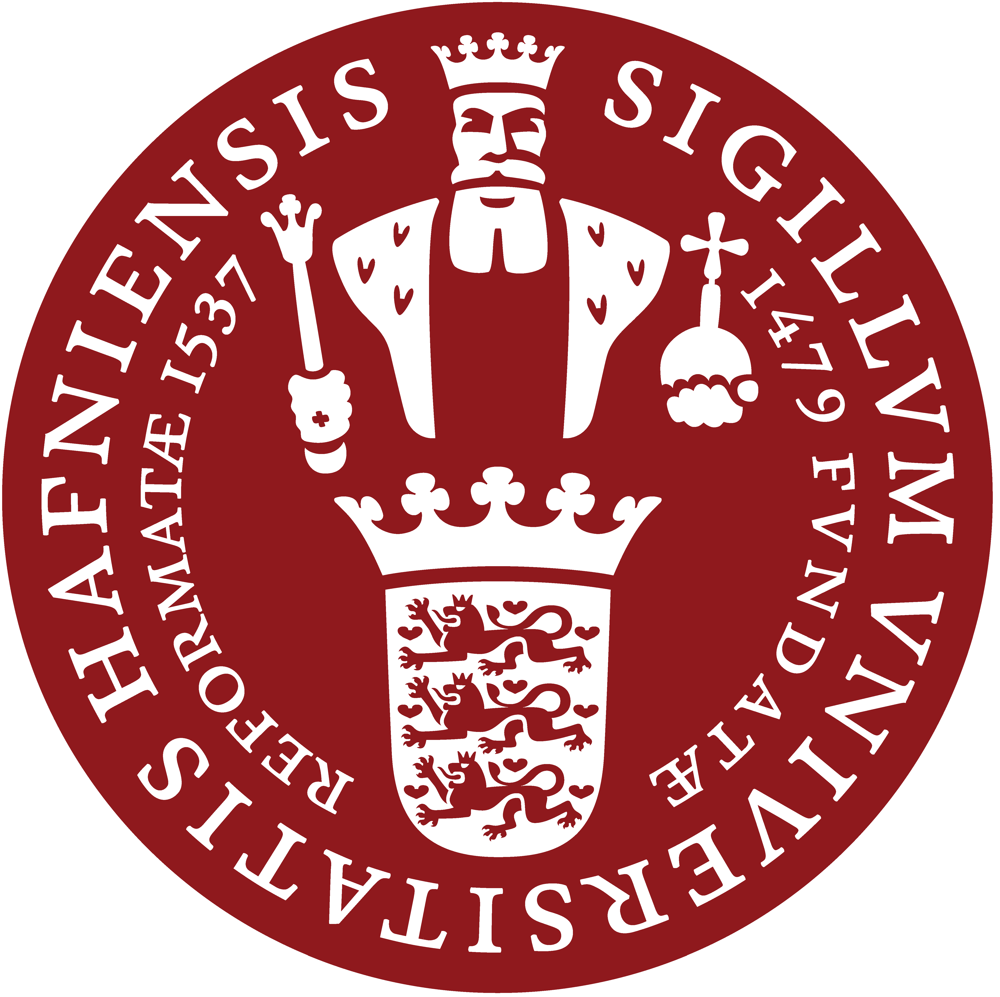

# Climate Adaptation of Democracy

## Climate impacts on environmental and democratic attitudes

Kasper M. Hansen --- Søren Damsbo-Svendsen --- Morten A. Dahl Larsen

*University of Copenhagen --- Danish Meteorological Institute (DMI)*

2026 -- 2028 

::: {style="display: flex; justify-content: space-around; align-items: center; margin-top: 4em; gap: 2em;"}
{width="100px"}

{width="100px"}

{width="100px"}
:::

